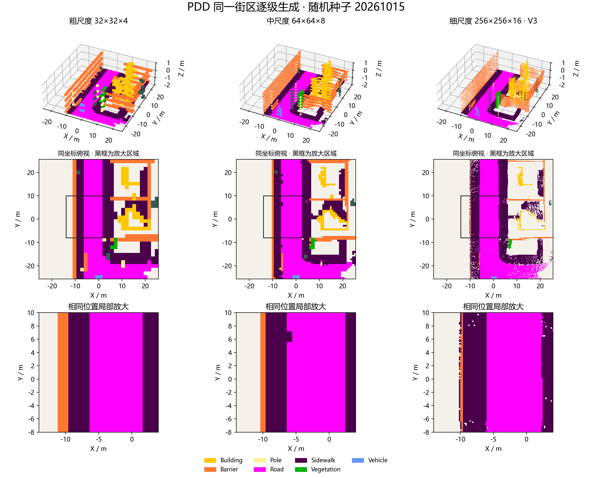
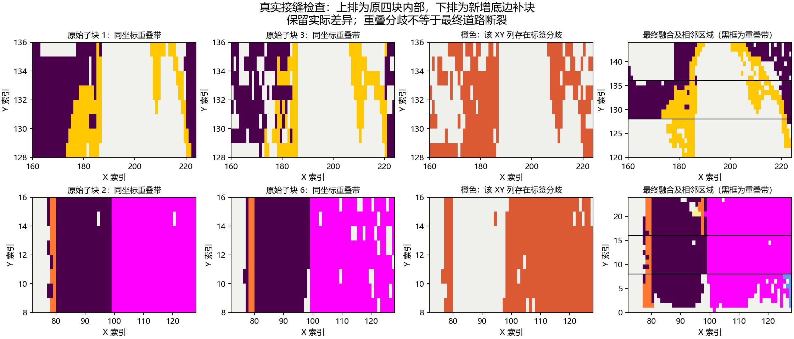

# PDD 成果与交接

已用作者公开权重跑通 CarlaSC 的粗到细三尺度生成。12 个固定种子完成细尺度完整覆盖检查，并导出了一个可供组内平台读取的 V3 主样例。补边恢复了首例原先落在切块外的车辆区域。

## 同一街区如何从粗到细



横向是粗、中、细三个状态，纵向分别是三维、俯视和同位置放大。三列均使用 `51.2 × 51.2 × 3 m` 的场景范围和同一色表。主路与两侧边界在三尺度中保持相近位置，细尺度在道路边缘和建筑轮廓上显示了更多细节。

| 状态 | 网格 | 体素尺寸（m） | 占据体素 |
|---|---:|---:|---:|
| 粗 `coarse` | 32×32×4 | 1.6×1.6×0.75 | 951 |
| 中 `medium` | 64×64×8 | 0.8×0.8×0.375 | 3,615 |
| 细 `fine` | 256×256×16 | 0.2×0.2×0.1875 | 49,880 |

主样例种子为 `20261015`。S2 使用本次 S1 的生成结果，S3 使用本次 S2 的生成结果。归档九块重建的 V3 与交付细尺度 TXT 逐字节一致。[主样例清单](../../examples/pdd/carlasc-v3-20261015/manifest.json) · [主样例核验](results/sample-validation.json)

## 覆盖和子块衔接

公开实现的默认四块覆盖 61,504 个平面格，边带有 4,032 格未进入生成。V1 补边后，12 例都覆盖了 65,536 个平面格，第一个种子的遗漏车辆区域恢复了 75 个车辆标签体素。[车辆区域前后对照](results/coverage-vehicle-v1.png)



主样例 V3 在域内九块中心融合上修补有原生预测支持的小空列。12 例汇总里，相对中心融合，条件道路内候选空列从 11,229 减到 9,766。图中 V1 接缝对照用于检查原始窗口分歧，V3 仍可见局部稀疏和部分小类漏检。另保留 Town07 Heavy `000000` 的真实粗条件生成对照。上述结果对应本次条件与生成实验，论文的 1,000 场景独立网络评估未运行。[V3 批次汇总](results/v3-batch-summary.json) · [真实粗条件对照](results/real-coarse-town07.png)

## 平台接入

```text
examples/pdd/carlasc-v3-20261015/
├── manifest.json
├── display/                   # 粗、中、细三个展示 JSON
└── source/                    # 原生 TXT、推理 YAML、日志及指标
```

`manifest.json` 登记色表、体素尺寸相关信息、来源和各状态的相对路径。展示点使用 `[x,y,z,label_id]`，单位为米，+Z 向上。原生 TXT 每行是 `[label,x,y,z]`。坐标中心按 `[-25.6,-25.6,-2] + (index + 0.5) × voxel_size` 计算，V3 的三个状态均已对齐。

本地逐点核验了三个状态的坐标、尺寸和标签。独立查看器用同一份 V3 主样例完成粗、中、细切换与俯视的离线浏览器测试。组内平台接入由平台负责人试读验收。[本地查看器截图（V3）](results/viewer-v3.png) · [浏览器测试](results/viewer-v3-validation.json) · [复跑与查看说明](README.md)

## 个人贡献

完成 CarlaSC 上的 PDD 三级公开权重推理、条件链核验、S3 子块覆盖与车辆漏生成定位、补边与原生支持的小空列修补，以及同视角效果图和平台样例导出。主样例为 `carlasc-v3-20261015`。
