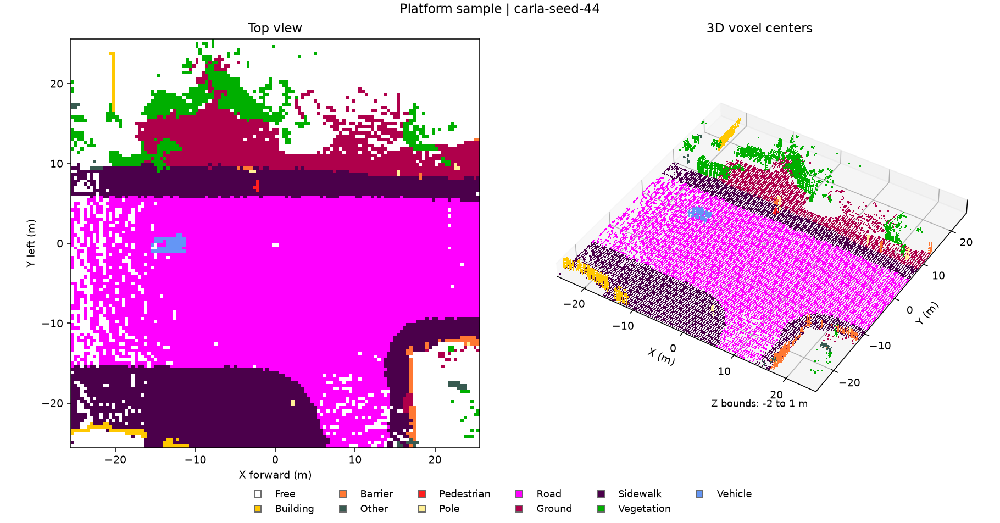
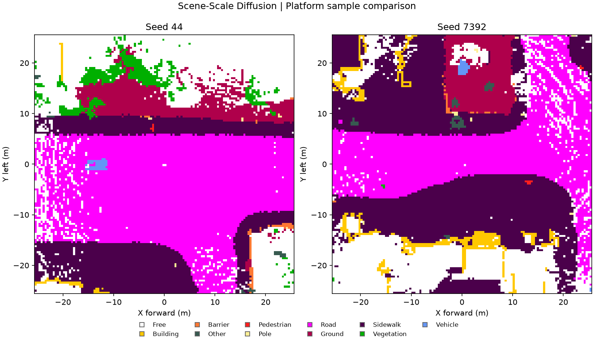
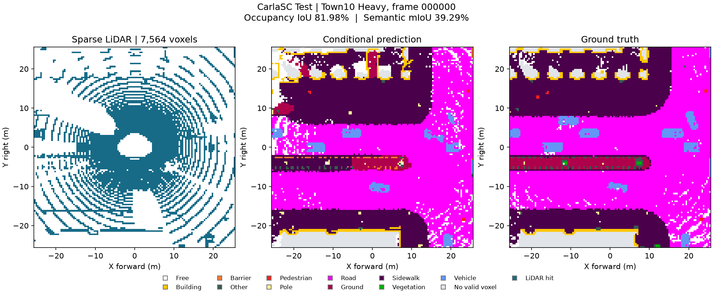
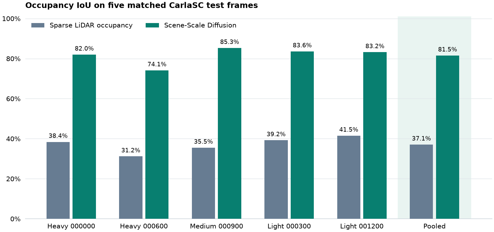
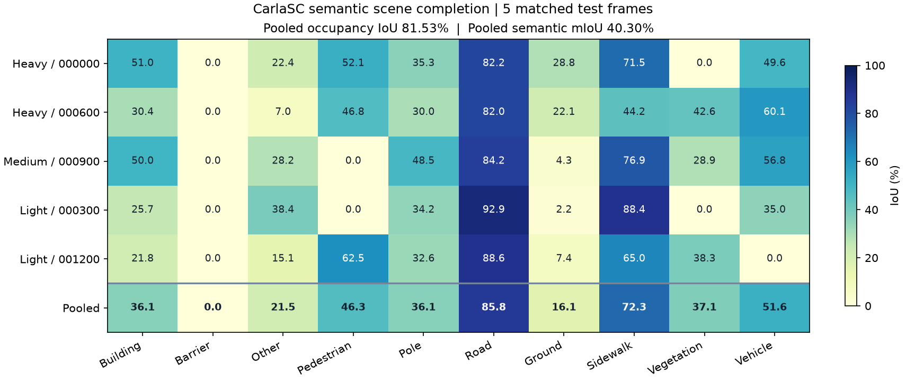

# Scene-Scale Diffusion 成果与交接

贡献者 `zlr2005` · 更新于 2026-11-26

已使用官方公开权重完成 CarlaSC 上的 **14 个种子无条件生成、5 帧语义场景补全评估、2 个平台样例包导出**。下面的图片、指标、代码和样例入口可用于平台接入、组内汇报及报告撰写。

| 已完成的工作 | 产出 | 队友可以如何使用 |
|---|---|---|
| 配置推理环境并调用官方采样器 | 固定代码版本、权重来源、环境记录和运行命令 | 按运行说明复跑 |
| 无条件生成与结果检查 | 14 个种子的原生语义体素、运行日志、道路连通性与类别统计 | 选代表场景，说明样本差异 |
| 条件补全与定量评估 | 5 帧观测、预测、真值、有效区掩码及逐类指标 | 汇报补全效果，核对指标计算范围 |
| 稀疏 LiDAR 基线对照 | 逐帧及合并占据指标、对照图、可复算脚本 | 分析模型恢复缺失占据的收益和误报 |
| 平台数据导出 | 种子 44、7392 的清单、展示数据、原生数组和配置日志 | 从 `manifest.json` 开始接入平台 |

## 生成了什么场景

无条件生成从随机噪声开始，输出 `128 × 128 × 8` 的语义体素。体素尺寸为 `0.4 × 0.4 × 0.375 m`，对应约 `51.2 × 51.2 × 3 m` 的空间范围。`0` 表示空闲，`1–10` 为建筑、栏杆、其他、行人、杆、道路、地面、人行道、植被和车辆。



同一个种子 44 场景在左侧显示俯视布局，右侧显示三维体素中心。粉色为道路、蓝色为车辆、绿色为植被、黄色为建筑。三维图使用米制坐标，展示高度范围为 `−2～1 m`。这张静态图可直接用于说明三维语义输出。



两个种子使用相同权重和采样设置。种子 44 作为主展示样例，7392 用于观察道路边缘和支路的破碎现象。道路连通性按俯视道路格的四邻域计算，表中的占比为最大连通块格数除以全部道路格数。

| 平台样例 | 占据体素数 | 非空语义类别数 | 最大道路连通块占比 | 清单入口 |
|---|---:|---:|---:|---|
| `carla-seed-44` | 13,490 | 10 | 97.93% | [主样例 manifest](../../examples/scene-scale-diffusion/carla-seed-44/manifest.json) |
| `carla-seed-7392` | 15,679 | 10 | 94.45% | [对照样例 manifest](../../examples/scene-scale-diffusion/carla-seed-7392/manifest.json) |

14 个种子均以 `batch_size=1` 运行 100 个扩散步，单样例采样耗时约 15.7–17.3 秒。最大道路连通块占比为 94.45%–100%，其中 13 个样例存在额外道路碎片。建筑出现在 8 个样例中，车辆出现在 6 个样例中。这些统计描述本次生成的 14 个样例。

## 稀疏观测补全成了什么

条件补全使用同一帧的稀疏 LiDAR 占据作为输入，预测语义体素，并与 CarlaSC 测试集真值对照。已完成 Town10 重度、中度和轻度交通序列中的固定 5 帧。



图中从左到右为稀疏 LiDAR、条件预测、真值。该帧输入包含 7,564 个 LiDAR 命中体素，预测恢复了更连续的道路和人行道区域，并给出车辆等语义标签。该帧占据 IoU 为 81.98%，语义 mIoU 为 39.29%。

### 五帧结果

| 序列及帧号 | 占据 IoU | 语义 mIoU |
|---|---:|---:|
| `Town10_Heavy/000000` | 81.98% | 39.29% |
| `Town10_Heavy/000600` | 74.12% | 36.52% |
| `Town10_Medium/000900` | 85.29% | 37.77% |
| `Town10_Light/000300` | 83.60% | 31.67% |
| `Town10_Light/001200` | 83.18% | 33.13% |
| **五帧合并** | **81.53%** | **40.30%** |

评估使用官方 `counts > 0` 的有效区，五帧共 574,206 个有效体素。占据 IoU 合并所有非空语义类别。语义 mIoU 对并集非零的非空语义类别取平均，排除空闲类。合并结果先累加交集和并集，再计算各类 IoU，最后取平均。本次合并纳入 10 个语义类别。[汇总指标及逐帧日志索引](results/completion-five-summary.json)

### 与原始稀疏 LiDAR 相比



| 五帧有效区上的占据预测 | 占据 IoU | 精确率 | 召回率 | 误报体素数 |
|---|---:|---:|---:|---:|
| 原始稀疏 LiDAR | 37.07% | 97.52% | 37.42% | 849 |
| 条件补全 | 81.53% | 94.13% | 85.90% | 4,773 |

条件补全的占据 IoU 提高 **44.46 个百分点**。在 LiDAR 未命中的有效体素中，真值占据 55,758 格，模型正确恢复 43,862 格，召回率为 78.66%。恢复更多占据的同时，误报也增加。这个子集按 LiDAR 是否命中划分，包含遮挡和采样稀疏等因素造成的空缺。[逐帧与合并对照统计](results/completion-five-occupancy-comparison.json)

### 哪些类别效果更好



道路、人行道、车辆的合并 IoU 分别为 **85.81%、72.30%、51.61%**，地面类为 **16.13%**。五帧有效区的真值中没有栏杆类，模型预测了 1,632 个栏杆体素，因此该类 IoU 为 0%。汇报时应同时给出整体补全收益和逐类差异，所有定量结果的评估范围均为这 5 帧。

## 队友可以直接接收哪些文件

### 平台负责人

两个无条件生成样例均已包含清单和原生数组，可从上表的清单入口读取。每包的结构如下。

```text
carla-seed-44/                 # 对照包为 carla-seed-7392/
├── manifest.json             # 方法、样例、标签、状态和来源
├── display/
│   └── generated.json        # 体素尺寸及 [x, y, z, label_id] 点列表
└── source/
    ├── voxels.npy            # 原生语义体素
    ├── config.json           # 采样设置、原生坐标及展示变换
    └── run.json              # 种子、耗时、类别计数和环境记录
```

展示坐标统一为米、右手系、`+Z` 向上，采用 `X` 向前、`Y` 向左。原生数组轴顺序为 `x, y, z`，从原生体素中心到展示坐标的转换为 `display_xyz = ([-25.6, -25.6, -2.0] + (index_xyz + 0.5) × [0.4, 0.4, 0.375]) × [1, -1, 1]`。标签和色表按各包 `labels` 字段读取。

本地已核对清单引用、原生数组形状、类别计数，以及每个展示点的坐标和标签。接入平台后，还需核对三维与俯视方向、颜色、比例、两包切换和离线加载效果。[平台接入规范](../../docs/三维语义城市场景生成_平台接入规范.md)

### 报告和 PPT 汇总者

本文的 5 张图片均在仓库的 `results/` 目录，可直接用于汇报。五帧汇总 JSON 中的 `run_path` 指向同目录下的逐帧 `run.json`，可查回采样设置、耗时和逐类指标。两个生成样例则通过各自清单定位配置和原生数组。

本地 `outputs/scene-scale-diffusion/` 另保存 14 个种子的完整生成记录，以及五帧补全的 `observation.npy`、`prediction.npy`、`ground_truth.npy`、`valid_mask.npy`。仓库交付了两个生成样例的原生数组，五帧补全的数组可联系本方法负责人获取或按运行说明生成。

### 需要复跑的同学

| 脚本 | 用途 |
|---|---|
| [sample_discrete.py](sample_discrete.py) | 调用官方无条件采样器，保存体素和运行记录 |
| [export_sample.py](export_sample.py) | 将无条件生成结果导出为平台样例包 |
| [fetch_completion_frame.py](fetch_completion_frame.py) | 从官方压缩包提取匹配帧的 LiDAR、真值和评估数据 |
| [complete_scene.py](complete_scene.py) | 条件补全，保存观测、预测、真值、掩码和指标 |
| [compare_completion.py](compare_completion.py) | 复算稀疏 LiDAR 与补全结果的占据对照 |

已验证环境为 Windows、Python 3.13.12、PyTorch 2.11.0+cu128、RTX 5060 Laptop GPU，依赖含 NumPy、einops 0.8.2 和 PyYAML 6.0.3。模型与权重来自官方公开实现，固定上游版本为 `a23745f37eddedefbf9b6069a0af8ec8b4d0f830`。本次贡献包括推理入口、匹配帧提取、评估对照、样例导出和结果材料整理。完整命令、源码与权重来源见运行说明。[环境与复跑说明](README.md)

## 当前还需要哪些交接

| 事项 | 当前状态及下一步 |
|---|---|
| 无条件生成与条件补全实验 | 已完成，结果与证据见本文 |
| 两个无条件生成展示包 | 已导出并完成本地回读，待平台负责人实际加载验收 |
| 平台中的条件补全展示 | 原生结果和对照图已具备，需进一步打包 `condition`、`output`、`ground_truth` 状态 |
| 平台三维交互 | 已具备静态三维预览图，旋转、缩放和切换需在平台中联调 |
| PrITTI 异常人工复核 | 待接收 PDD 负责人提供的疑似异常编号、位置和截图 |
| 四人报告与展示核对 | 待收齐各方法技术小节、案例编号和平台验收反馈 |

组内验收按分工清单逐项交接。[四人分工与验收](../../docs/三维语义城市场景生成_四人分工与验收.md)
